# 검증 기록

## V-20261119-05: Git 게시 전 재검사

- Windows PowerShell에서 `powershell -NoProfile -ExecutionPolicy Bypass -File .\build.ps1 -Test`를 다시 실행했다. `PASS: 170 checks (scheduling + songs + persistence)`와 `PASS: 198 Swing checks`, 종료 코드 0이었다. 같은 검사의 재실행이므로 기존 368개에 합산하지 않는다.
- `git diff --cached --check`는 공백 오류 없이 종료 코드 0이었다. `data/`와 `out/`은 `.gitignore`에 따라 Git 대상에서 제외된 것을 확인했다. 이 검사는 실제 네이티브 마우스 조작이나 원격 게시 결과를 검증한 것은 아니다.

## V-20261119-04: H50 제출용 PDF 재검증과 링크 수정

- 사용자 재검증 요청. `pypdf`로 PDF 주석을 확인하니 첫 판본의 링크 10개가 모두 작업용 `out/report-preview/` 경로를 가리켰다. 실제 제출 PDF에서 열리지 않는 링크이므로 생성 스크립트가 PDF에는 근거 파일명을 텍스트로 인쇄하도록 수정했다. Markdown 원본의 상대 링크 10개는 유지하고 파일 존재를 전부 확인했다.
- `python docs/render_development_report.py` 재실행 후 PDF **6쪽**, 텍스트 추출 가능, 대체 문자 **0개**, PDF 주석/데드 파일 링크 **0개**. 1·3·4·5·6쪽을 다시 렌더링해 한글·표·쪽나눔을 눈으로 확인했다. Windows PowerShell/JDK 17.0.20.1에서 `powershell -NoProfile -ExecutionPolicy Bypass -File .\build.ps1 -Test`를 재실행해 `PASS: 170 checks (scheduling + songs + persistence)` / `PASS: 198 Swing checks`, 종료 코드 0을 얻었다. 이번에는 GUI 렌더 자동 검사를 별도 재실행하지 않았다.
- 보고서의 1~6절·요구사항 10개·코드 상수(계획 5개, 멤버 상한 64, 곡 2/3 계산)를 대조했다. 첫 자동 문서 점검은 검사 스크립트의 정규식 이스케이프 실수로 6절을 0개로 잘못 셌고, 정규식을 바로잡아 6/6 통과했다. 제품 결함으로 기록하지 않는다. `git diff --check`는 공백 오류 없이 종료 코드 0. PDF 생성·자동 검사가 학생 본인의 실제 Demo 시연이나 동료 검토를 대신하지는 않는다.

## V-20261119-03: H49 개발 문서·PDF 점검

- Windows PowerShell, Temurin `java`/`javac` 17.0.20.1. `powershell -NoProfile -ExecutionPolicy Bypass -File .\build.ps1 -Test`: `PASS: 170 checks (scheduling + songs + persistence)` / `PASS: 198 Swing checks`, 합계 368개, 종료 코드 0. `java -Dfile.encoding=UTF-8 -cp out GuiSmokeTest --render`: `PASS: 198 Swing checks`, 종료 코드 0. 렌더 실행 수는 합계에 더하지 않았다. 사용자 `data/`는 변경하지 않았다.
- `python docs/render_development_report.py`로 Markdown 원본을 HTML로 변환하고 로컬 Edge headless 출력으로 `docs/BandDecision_Development_Report.pdf`를 생성했다. `pypdf`로 **6쪽·텍스트 추출 가능**을 확인했고 `pypdfium2`로 6쪽 전체를 PNG로 렌더링해 한글·표·쪽나눔을 눈으로 확인했다. Edge 첫 실행은 상대 프로필 경로의 잠금 오류로 PDF가 없었고, 작업 공간의 절대 프로필 경로로 재실행해 생성했다. PDF 원본은 `docs/DEVELOPMENT_REPORT.md`다.
- 12주차 자료 9쪽의 6항목에 대해 보고서 1~6절과 마지막 대응표를 대조했다. 코드에서 `BandDecision`·`Song`·`DateRecommender`·`DataStore`·`DemoData`의 기준과 보고서 수치·정책을 대조했다. 이는 문서의 내용과 자동 검사 근거 확인이며 동료 직접 평가·학생 직접 시연·발표자료·실제 이메일 제출의 완료 증거는 아니다.
- 최종 원본의 `## 1`~`## 6` 절 **6/6**, Markdown 상대 링크 **10개 모두 존재**, PDF **6쪽·추출 문자 9002자·U+FFFD 대체 문자 0개**, `368`과 `Demo` 텍스트 존재를 확인했다. `git diff --check`는 공백 오류 없이 종료 코드 0이었다. 이 자동 점검은 내용의 채점 결과나 사람의 사용성 평가를 대신하지 않는다.

## V-20261119-02: H47 12주차 PDF·개발 문서 대조

- `python -c "import pypdf ..."`로 `2026-2 Java 12주차.pdf`를 열어 **11쪽**의 텍스트를 추출했다(종료 코드 0). `pypdfium2`로 9~11쪽을 이미지로 렌더링해 눈으로 확인했다. 3쪽의 제출 기한·형식, 6~7쪽의 동료 검토, 9쪽의 문서 평가 6항목, 10~11쪽의 발표 평가·준비를 대조했다.
- 현재 문서 검색에서 11주차 근거와 사용자 제공 평가 6항목은 있었지만 12주차 PDF 자체의 대조 기록은 없었다. `DEVELOPMENT.md`의 현재 구현 표에 콘솔·6명 고정 설명, `docs/EVALUATION.md`에 N명 범위 밖 표기, `docs/SUBMISSION.md`에 이전 검사 수가 남아 있어 수정했다.
- 문서만 수정했다. H46/V-20261119-01의 368개 자동 검사를 이번 작업에서 재실행한 것으로 표기하지 않는다. 동료 검토·학생 직접 시연·발표자료 PDF·제출 메일도 실행하거나 작성하지 않았다.

## V-20261119-01: H46 적용 안내·저장·달력 글자색

- Windows PowerShell, JDK 17, 별도 임시 데이터에서 `powershell -NoProfile -ExecutionPolicy Bypass -File .\build.ps1 -Test`: `PASS: 170 checks (scheduling + songs + persistence)` / `PASS: 198 Swing checks`, 총 368개, 종료 코드 0. Swing 검사는 기간 5일 선택 후 대상 멤버와 적용 일수가 표시되고 직접 편집 날짜를 별도로 알려주는지 확인한다. 저장 재시도 버튼의 저장 동작과 전체 기간 응답 표시도 기존·수정 검사로 확인했다.
- `java -Dfile.encoding=UTF-8 -cp out GuiSmokeTest --render`: `PASS: 198 Swing checks`, 종료 코드 0. [일정 화면](evidence/2026-11-19/schedule-clear-actions.png)에서 안내의 버튼 위 배치와 요일·날짜·상태의 검정 글씨, [밴드 설정 화면](evidence/2026-11-19/settings-save-retry.png)에서 전체 기간 응답·저장 재시도 설명을 눈으로 확인했다. 렌더 검사는 위 368개에 중복 합산하지 않는다.
- 첫 빌드는 `DesktopUI`의 닫는 괄호 오타로 컴파일 오류가 났고 수정 후 위 두 명령을 다시 실행해 통과했다. 사용자 `data/` 파일은 변경하지 않았다. 실제 네이티브 마우스 전체 흐름은 미실행이다.

## V-20261118-10: H45 사이드바 멤버 선택기

- `powershell -NoProfile -ExecutionPolicy Bypass -File .\build.ps1 -Test`: `PASS: 170 checks (scheduling + songs + persistence)` / `PASS: 197 Swing checks`, 총 367개, 종료 코드 0. Swing 검사는 선택기가 `WorkspaceView` 내부에 있고 브랜드 아래·일정 버튼 위에 있으며 일정·투표가 같은 선택기를 사용하는지 확인한다. 90/100/140% 배율과 1080×800/1280×930 크기의 기존 접근성 회귀도 통과했다.
- `java -Dfile.encoding=UTF-8 -cp out GuiSmokeTest --render`: `PASS: 197 Swing checks`, 종료 코드 0. [사이드바 렌더링](evidence/2026-11-18/member-selector-in-sidebar.png)에서 BAND DECISION → 입력할 멤버 → 일정 순서를 확인했다. 렌더 검사는 위 367개에 중복 합산하지 않는다.
- 사용자 `data/` 파일은 변경하지 않았다. 실제 Windows 창 마우스 조작은 V-20261118-09의 연결 오류로 이번에는 재시도하지 않았다.

## V-20261118-09: H44 요청 항목 재점검

- `powershell -NoProfile -ExecutionPolicy Bypass -File .\build.ps1 -Test`: `PASS: 170 checks (scheduling + songs + persistence)` / `PASS: 197 Swing checks`, 총 367개, 종료 코드 0.
- `java -Dfile.encoding=UTF-8 -cp out GuiSmokeTest --render`: Swing 197개 통과, 종료 코드 0. [달력 렌더링](evidence/2026-11-18/schedule-black-date-numbers.png)에서 지난 날짜와 현재 날짜의 숫자 모두 검정이며 지난 날짜 배경은 비활성 상태로 구분되는 것을 확인했다. 렌더 검사는 위 합계에 중복하지 않는다.
- 멤버 추가·장소 입력의 실제 Windows 창 조작을 시도했지만 `Computer Use native pipe is unavailable: failed to connect native pipe`가 재시도·커널 재시작 후에도 반복됐다. 다른 UI 연결 도구도 같은 오류였다. 테스트 전용 `out/cua-audit` 데이터 경로로 띄운 프로세스는 종료했다. 실제 대화상자 마우스 조작은 미검증이며 사용자 `data/`는 변경하지 않았다.

## V-20261118-08: H43 합주 장소

- `powershell -NoProfile -ExecutionPolicy Bypass -File .\build.ps1 -Test`: 도메인 170개·Swing 197개, 합계 367개 통과, 종료 코드 0. 장소 공백 정리·상세 표시, 최종 확인 뒤 장소 변경 거부, 저장·복원, 계획 장소 수정, 목록 표시와 수정 입력란 자동 채우기를 확인했다. 멤버 수·장소 속성이 없는 이전 v3 파일도 6명·장소 미정으로 복원했다.
- `java -Dfile.encoding=UTF-8 -cp out GuiSmokeTest --render`: Swing 197개 통과, 종료 코드 0. [계획 작성 장소 입력](evidence/2026-11-18/plan-location-field.png)과 [확정 목록의 장소·분류](evidence/2026-11-18/plan-history-location.png)를 렌더링으로 확인했다. 이 197개는 위 합계에 중복 합산하지 않는다.
- 기존 장소 없는 계획은 ‘미정’으로 표시한다. 저장 파일이 없는 임시 폴더의 검사 데이터를 사용했고 사용자 `data/`는 수정하지 않았다. 장소 입력·확정 대화상자의 실제 마우스 조작은 미실행이다.

## V-20261118-07: H42 멤버·화면 개선

- 첫 `build.ps1 -Test`에서 도메인 162개 통과 후 GUI에서 선택기 갱신 중 `멤버 번호가 잘못되었습니다` 예외로 종료 코드 1. 원인은 항목을 지울 때 선택 인덱스가 일시적으로 -1이 된 상태에서 달력 갱신이 실행된 것이다. 멤버 배열을 먼저 교체하고 -1 선택 이벤트를 무시하도록 수정했다.
- 재실행에서 7명 기본 난이도·미응답, 일정/투표 추천 재개, 같은 파트·이름·실력 수정과 잘못된 파트 변경의 원자성, v3 저장·복원, 7명 확정 계획, 7명 찬성 2/3 기준, GUI 표·선택기 동기화와 예정/이전 계획 필터가 통과했다. 최종 전체 명령 결과는 V-20261118-08의 170+197=367개, 종료 코드 0이다.
- [달력 선택기·아이콘 범례](evidence/2026-11-18/schedule-member-legend.png)와 [곡별 투표 요약](evidence/2026-11-18/song-vote-summary.png)을 렌더링으로 확인했다. 날짜 숫자 검정과 집계의 줄임표 없는 표시를 확인했다.
- 자동 검사는 멤버 추가·수정 대화상자의 실제 마우스 입력을 대신하지 않는다. 로컬 다중 사용자 동시 사용도 검사하지 않았다.

## V-20261118-06: H41 화면의 곡 ID 숨김

- `powershell -NoProfile -ExecutionPolicy Bypass -File .\build.ps1 -Test`: `PASS: 157 checks (scheduling + songs + persistence)` / `PASS: 188 Swing checks`, 총 345개, 종료 코드 0. 후보곡 표 2열·추천곡 표 6열을 확인하고, 삭제 후 선택 곡의 투표 연결과 계획 수정 시 추천곡 선택도 기존 회귀 검사로 통과했다. 확정 계획 설명에 내부 곡 ID가 나타나지 않는지 추가 확인했다.
- `java -Dfile.encoding=UTF-8 -cp out GuiSmokeTest --render`: `PASS: 188 Swing checks`, 종료 코드 0. [후보곡 화면](evidence/2026-11-18/song-list-without-id.png)과 [계획 작성 화면](evidence/2026-11-18/recommendations-without-song-id.png)에서 ID 열이 사라지고 제목·아티스트가 표시되는 것을 확인했다. 렌더 검사는 위 합계에 중복 합산하지 않는다.
- 전체 투표 결과 대화상자와 삭제 확인창의 실제 마우스 조작은 미실행이다. 사용자 `data/` 파일은 변경하지 않았다.

## V-20261118-05: H40 확정 합주 색상 구분

- `powershell -NoProfile -ExecutionPolicy Bypass -File .\build.ps1 -Test`: `PASS: 157 checks (scheduling + songs + persistence)` / `PASS: 186 Swing checks`, 총 343개, 종료 코드 0. Swing 검사에서 확정 날짜 두 개가 개인 응답·전원 가능 상태와 관계없이 연보라 배경인지, 계획 삭제 후 색상이 사라지는지 확인했다.
- `java -Dfile.encoding=UTF-8 -cp out GuiSmokeTest --render`: `PASS: 186 Swing checks`, 종료 코드 0. [달력 렌더링](evidence/2026-11-18/confirmed-calendar-purple.png)에서 확정 날짜 11/22가 보라색이고 일반 가능 날짜는 파란색으로 구분되는 것을 확인했다. 렌더 검사 186개는 위 합계에 중복 합산하지 않는다.
- 실제 마우스 조작을 통한 전체 시연은 미실행이다. 사용자 `data/` 파일은 변경하지 않았다.

## V-20261118-04: H39 확정 계획 달력 표시

- `powershell -NoProfile -ExecutionPolicy Bypass -File .\build.ps1 -Test`: 첫 회 도메인 157개 통과 후 GUI 검사 `확정 계획 날짜의 달력 표시·상세·툴팁`에서 AssertionError, 종료 코드 1. 테스트는 선택 날짜의 계획 #3을 #1로 기대한 오류였다. 제품 로직 변경 없이 기대 ID를 바로잡았다.
- 최종 같은 명령: `PASS: 157 checks (scheduling + songs + persistence)` / `PASS: 186 Swing checks`, 총 343개, 종료 코드 0. 추가 조건 4개는 확정/비확정 날짜, 선택 날짜·툴팁, 수정 후 표시 이동, 삭제 후 표시 제거다.
- `java -Dfile.encoding=UTF-8 -cp out GuiSmokeTest --render`: 186 Swing checks 통과, 종료 코드 0. [달력 렌더링](evidence/2026-11-18/confirmed-calendar.png)에서 11/22 날짜 카드 '합주 확정'과 오른쪽 '확정 계획 #1'이 보이는 것을 확인했다. 이 렌더 검사는 343개에 중복 합산하지 않는다.
- 사용자 data 파일은 변경하지 않았다. 실제 마우스 전체 흐름은 미실행이며 렌더링·컴포넌트 검사와 구분한다.

## V-20261118-03: H38 -Demo 통합

- Main의 --demo 생성 분기를 발표 데이터로 통합하고 두 스크립트의 Presentation 옵션을 제거했다.
- 로컬 demo.properties를 고유 이름 .bak로 복사한 뒤 준비된 presentation.properties를 demo.properties로 복사했다. 일반 파일은 변경하지 않았다. 원래 발표 파일도 삭제하지 않았다.
- `powershell -NoProfile -ExecutionPolicy Bypass -File .\build.ps1 -Test`: `PASS: 157 checks (scheduling + songs + persistence)` / `PASS: 182 Swing checks`, 총 339개, 종료 코드 0.
- 실제 GUI를 다시 실행한 네이티브 시연은 미실행. 현재 안내는 -Demo이며 이전 별도 옵션 기록은 과거 이력이다.

## V-20261118-02: H37 발표용 가상 데이터

- Windows PowerShell/JDK 17, 개발 지원 도구 실행. `build.ps1 -Test` 실제 출력: `PASS: 157 checks (scheduling + songs + persistence)` / `PASS: 182 Swing checks`, 종료 코드 0. 총 339개.
- createPresentation을 실제 기준일, 2026-12-31, 2028-02-29로 생성해 각각 8곡/2계획, 개인 완료와 미완료, 전원 가능/불가/미응답, 추천 자격 4곡 조건 검사. 12개 모두 통과.
- 사용자가 요청한 시연 데이터를 별도 data/presentation.properties에 생성했다. 임시 준비 도구는 out에만 두고 파일이 이미 있으면 거절하도록 했다. 실제 저장·재로딩 출력 `dates=44, songs=8, plans=2`. 생성 기준일 2026-11-18. 일반 banddecision.properties와 기존 demo.properties는 수정하지 않았다.
- 이 준비 파일은 사용자가 요청한 가상 데이터이며, 테스트 때문에 사용자 기존 저장 파일을 초기화한 것이 아니다. 파일은 git 제외 대상. 새 모드는 다음 실행에서 기존 내용을 읽는다.
- 이번 GUI 네이티브 마우스 시연·렌더링은 미실행. 기존 과거 결과는 당시 기록이다.

## V-20261118-01: H35 GUI 전용 정리

- 환경: Windows PowerShell/JDK 17, 임시 테스트 데이터. 사용자 data 및 백업 파일 변경 없음.
- 첫 `powershell -NoProfile -ExecutionPolicy Bypass -File .\build.ps1 -Test`: `PASS: 145 checks (scheduling + songs + persistence)` / `PASS: 180 Swing checks`, 종료 코드 0.
- 기본 진입점 추가 검사: 임시 dataDir 설정 → Main.main(빈 인자) → EDT에서 표시된 DesktopUI 확인·닫기 → 파일 로딩. GUI 기본 실행과 자동 저장 로딩 2조건 통과.
- 최종 같은 명령: `PASS: 145 checks (scheduling + songs + persistence)` / `PASS: 182 Swing checks`, 합계 **327개**, 종료 코드 0. 실패/SKIP 없음.
- 제거 범위: 과거 377개 중 콘솔·문자열 파서·수동 백업 52개 조건 폐기. GUI 백업 버튼 존재 검사는 부재 검사로 교체. 새 GUI 진입점 2개 추가. 테스트 감소는 기능 범위 축소에 따른 것으로 기존 실패를 숨긴 것이 아니다.
- 정적 검사: 소스/테스트에 ConsoleUI·DateParser·BackupService 참조 없음. run.ps1 PowerShell 구문 검사 통과. 문서 12개·로컬 링크 92개 존재 확인 통과. 삭제한 클래스의 out 잔여 파일도 제거.
- 한계: 새 이미지 렌더링·네이티브 마우스 전체 시연·다른 PC 확인 미실행. GUI 시작/종료는 자동 컴포넌트 검사이며 수동 시연이 아니다. 과거 콘솔/백업 검증 기록은 당시 이력으로 보존한다.

## V-20261113-01: H34 수업 제출 점검

현재 최신 기능 검사는 **197개 + 180개 = 377개**다. 아래 11월 12일의 최신 표기는 당시 실행 기준이다.

- 환경: Windows PowerShell, JDK 17. 개발 지원 도구가 실행. 모든 변경 테스트는 임시 파일이며 사용자 data는 수정하지 않았다.
- 기준선: 프로젝트에서 `powershell -NoProfile -ExecutionPolicy Bypass -File .\build.ps1 -Test`. PASS 197 checks와 PASS 178 Swing checks, 종료 코드 0.
- 실패 재현: GuiSmokeTest.pendingEdits에서 사유 셀 편집 → 텍스트 입력 → 지금 저장.doClick → 파일 재로딩. `AssertionError: 지금 저장은 포커스 이동 없이도 편집 확정 후 저장`, 종료 코드 1. 도메인 197개는 통과했다. 비가시 설정 버튼을 컴포넌트로 직접 호출한 검사이며 네이티브 마우스 시연에서 발생했다고 주장하지 않는다.
- 수정: 지금 저장 동작이 finishEditing 후 save를 실행. 저장 성공 툴팁도 실제 저장 위치로 복구. 빌드 --release 17 추가.
- 새 폴더 검사: `$env:TEMP\BandDecision submission 8ad552b3-acad-42d8-b2a0-a8481ab2700d`에 src/test/스크립트만 복사. 기존 out/data 없이 해당 build.ps1 -Test 실행. `PASS: 197 checks (candidate scheduling + songs + persistence + CLI)` / `PASS: 180 Swing checks`, 종료 코드 0. 실패/SKIP 없음. 추가 2조건은 편집 시작과 편집 확정·파일 재로딩 일치다.
- 프로젝트 일반 build.ps1 재실행: 종료 코드 0, 경고 출력 없음.
- 다른 작업 폴더에서 위 복사본 run.ps1 -Demo에 0을 입력해 두 번 실행. 첫 실행은 샘플 날짜 7개·응답 42건·곡 4개·투표 23건 생성과 정상 종료, 두 번째는 저장 데이터를 불러오는 안내와 정상 종료 확인. javap -verbose 결과 major version 61(Java 17). 이 명령 묶음 종료 코드 0.
- 문서: EVALUATION의 R15/T11을 표에 반영하고 T12 추가, 현재/과거 검사 수 충돌 정리, SUBMISSION 안내 추가. 수업 범위를 넘어선 Swing/파일/record 등 추가 학습 항목과 설명할 질문을 명시했다.
- 문서 정적 검사: 12개 문서·92개 로컬 링크 존재, R01~R15/T01~T12 순서·누락, 연속 물음표 손상 검사 통과. 기능 377개와 별도다. 실제 Java 환경은 Temurin 17.0.20.1+1이었다.
- 한계: 같은 PC의 새 폴더 확인이다. 다른 PC, 실제 GUI 파일 선택/승인/취소 전체 흐름, 권한·디스크 부족 주입, 동시 실행은 미검증이다. 이번에는 네이티브 도구 재시도나 새 이미지 렌더링을 하지 않았다.

## V-20261112-05: H33 백업·복원·저장 안내

- 환경: 2026-11-12, Windows PowerShell/JDK 17, 개발 지원 도구가 별도 임시 데이터로 실행. 사용자 data 파일 변경 없음.
- 첫 `powershell -NoProfile -ExecutionPolicy Bypass -File .\build.ps1 -Test`: 196개 + 176개, 종료 코드 0. 이후 확정 계획·투표·응답 복원과 설정 진입점 검사를 추가했다.
- 최종 같은 명령: `PASS: 197 checks (candidate scheduling + songs + persistence + CLI)`와 `PASS: 178 Swing checks`, 종료 코드 0, 실패/SKIP 없음. 합계 375개로 H32 대비 12개 추가.
- T11 기대/실제: 새 백업 로드 성공, 기존 백업 덮어쓰기 거절·바이트 보존, 복원 결과 재로딩 일치, 미저장 메모리 안전 백업, 원본 백업 보존, 계획·반대 투표·불가 응답 보존, 손상 파일 거절·현재 파일 보존, 검증 실패 시 복구 파일 미생성, 현재 파일 자체 복원 거절, 안전 백업 실패 시 복원 중단. 10개 조건 모두 통과.
- Swing 추가 2조건: 설정 백업·복원 버튼 제공, 지금 저장 버튼의 파일 저장 연결. 파일 선택창과 확인창의 실제 승인/취소 클릭 검사는 아니다.
- `java -Dfile.encoding=UTF-8 -cp out GuiSmokeTest --render`: `PASS: 178 Swing checks`, 종료 코드 0. 화면 컴포넌트를 이미지로 렌더링했으며 합계 375개에 중복 가산하지 않는다. [설정 화면](evidence/2026-11-12/backup-settings.png)을 직접 열어 새 버튼 세 개의 배치를 확인했다.
- 네이티브 시도: Computer Use 스킬의 sky 초기화/list_windows 성공. 임시 폴더로 javaw 숨김 실행 후 목록에 창 없음. 해당 테스트 프로세스 종료 후 일반 java Main --gui --demo로 재실행해도 목록에 창 없음. 반환된 대상 창이 없어 클릭/입력하지 않았고 테스트 세션만 종료했다. 실제 마우스 전체 E2E는 미완료다.
- 문서 작성 중 PowerShell 파이프의 한글 인코딩 손상을 발견하여 해당 신규 문단만 제거하고 apply_patch로 재작성했다. 기존 기록은 유지했다.
- 한계: 실제 디스크 부족/권한 실패, 다른 PC/DPI, 동시 실행, 큰 파일 진행 표시, 학생 본인·동료 시연은 미완료. 사용 예시의 체크박스는 실행 증거가 아니다.
- 문서 정적 검사: Markdown 대상 10개·로컬 링크 88개 존재 확인과 연속 물음표 손상 검사 통과. 최초 검사기는 `<경로>` 구문을 제거하지 않아 링크를 오판했고 검사기 보정 후 통과했다. 기능 검사 375개에는 포함하지 않는다.

최신 기능 실행은 **V-20261112-05/H33, 197개 + 178개 = 375개**이다. 이 문서의 V-01 및 V01~V12 표·초기 화면은 H16 당시 정책과 결과다. 현재 요구사항/조건별 기대·실제 결과는 [평가 기준별 문서](EVALUATION.md) 2·5절과 해당 후속 V 기록을 따른다. 과거 수치·화면은 당시 정책의 결과로 보존한다.

## V-20261112-04: 추가 오류 테스트 H32

- 2026-11-12, Windows PowerShell/JDK 17, 개발 지원 도구가 프로젝트 폴더에서 임시 데이터로 실행. 사용자 저장 파일은 변경하지 않았다.
- 기준선 `powershell -NoProfile -ExecutionPolicy Bypass -File .\build.ps1 -Test`: 종료 코드 0, 기존 `PASS: 181 checks (candidate scheduling + songs + persistence + CLI)`와 `PASS: 173 Swing checks`. 기존 조건의 정상 결과이며 오류가 전혀 없다는 뜻으로 해석하지 않는다.
- 재현 A: 실제 셀 편집기로 일정 사유를 입력하고 `frame.refresh()`. 사유 저장 중 안쪽 refresh가 refreshing을 false로 바꿔 바깥쪽 곡 표 갱신이 선택 변경으로 처리됨. 추가 검사에서 `AssertionError: 일정 편집 중 전체 갱신해도 선택 곡·투표 멤버 보존`, 종료 코드 1. 수정은 전체 갱신 플래그 전에 finishEditing을 완료하는 순서 조정이다.
- 재현/보호 B: 날짜 전개는 실제 기간 검사 전 제한 없이 반복/복사하고 있었다. 안전한 63일 표본에서 `AssertionError: 두 달 최대 날짜 수를 넘는 범위는 펼치기 중 거절`, 종료 코드 1. 고유 날짜 상한 62개를 추가했고 그 뒤 9999년까지의 범위도 빠르게 거절되는지 실행했다. 실제 메모리 고갈·OS 종료 시험은 하지 않았다.
- 중간 재시험: 수정 후 186개 + 176개 통과, 종료 코드 0. 이어 콘솔 오류 안내 뒤 다음 메뉴 처리와 부분 기록 없음 검사를 추가해 최종 명령을 실행했다.
- 최종 `powershell -NoProfile -ExecutionPolicy Bypass -File .\build.ps1 -Test`: 종료 코드 0, 실패·SKIP 없음. 실제 출력:

```text
PASS: 187 checks (candidate scheduling + songs + persistence + CLI)
PASS: 176 Swing checks
```

- 기대/실제 A: 편집 시작 가능, 사유 확정 저장, 같은 곡 ID와 6명 투표/선택 멤버 유지 → 3개 회귀 검사 통과.
- 기대/실제 B: 62일 허용·63일 거절·혼합 고유 날짜 상한·중복 비가산·수천 년 범위 거절 → 5개 통과. 콘솔에 긴 범위 다음 멤버 메뉴/취소/종료를 연속 주입해 안내·다음 메뉴 도달·종료·날짜 기록 없음 → 1개 통과.
- 합계 363개는 H31의 354개에 새 조건 9개를 추가한 수다. 반복 실행 수를 합산하지 않는다. [실행 증거](evidence/2026-11-12/bug-audit-test-results.txt).
- 기존 저장/복원·v1/v2/v3·투표/추천·계획 5개·메뉴/선택 보존·3배율/2크기 접근도 최종 전체 검사에서 통과했다. 이번 화면 렌더링은 **미실행**이며 이전 H31 이미지를 갱신하지 않았다. 실제 네이티브 전체 마우스 E2E·다른 PC/DPI·동시 저장/디스크·권한 오류는 기존 미완료 범위로 유지한다.
- 문서 정적 점검 Python 출력 `PASS: 9 documents, 79 local links, R01-R14/T01-T10; H32 totals recorded`, 종료 코드 0. 링크·항목 ID·현재 결과 반영을 확인했으며 기능 검사 수에 합산하지 않는다.

## V-20261112-03: 세 작업 중심 UI/UX 통합 H31

- 2026-11-12, Windows PowerShell/JDK 17.0.20.1. 개발 지원 도구가 프로젝트 폴더에서 별도 임시 데이터로 실행했다. 사용자 저장 파일은 변경하지 않았다.
- 최종 `powershell -NoProfile -ExecutionPolicy Bypass -File .\build.ps1 -Test`: 종료 코드 0. 실제 출력:

```text
PASS: 181 checks (candidate scheduling + songs + persistence + CLI)
PASS: 173 Swing checks
```

- `java '-Dfile.encoding=UTF-8' -cp out GuiSmokeTest --render`: 종료 코드 0, `PASS: 173 Swing checks`. 같은 검사를 반복하므로 추가 합산하지 않는다. [명령/출력 증거](evidence/2026-11-12/workspace-test-results.txt).
- 새 흐름 조건 11개: 사이드바 버튼 이동, 상단/달력 선택기 동일 객체, 목록에서 상세/투표 연동, 상단 변경과 투표표 멤버 일치, 정확한 곡/멤버의 반대·사유 저장, 찬성 재투표 사유 제거, 계획 작성 전환, 설정 이동, 메뉴 왕복 계획 선택 보존, 일정 날짜/멤버 보존, 이동만으로 파일 무변경. 서비스 직접 변경뿐 아니라 실제 Swing 버튼 doClick·선택 이벤트를 실행했다.
- 크기/배율: 기존 3배율×2크기×6주요 동작 접근 36개와 일정 되돌리기 6개를 유지했다. 고정 멤버 선택기의 전체 노출/글자 높이 6개, 실제 셀 렌더러의 멤버 이름/찬반 배지 선호 너비를 충족하는지 6개 추가. 최소 창/140%에서는 작업 영역 스크롤을 사용한다. 실제 Windows DPI 변경 시험은 아니다.
- 실패→수정: 최초 통합 후 기본 투표 6행 검사 실패(viewport 245px, 행 43px, 종료 코드 1). 폰트/여백을 고려한 행 높이로 조정했다. 정상 샘플 렌더링에서 이름과 찬반이 줄임표로 표시되는 문제도 발견해 배율별 열 최소 너비를 설정하고 위 회귀 검사 추가. 최종 6행·너비·접근 검사 모두 통과했다.
- 검사 수 변경: H30의 Swing 151개에서 흐름 11개+메뉴 존재 1개+선택기 6개+투표 너비 6개를 추가하고 옛 6탭 이동 6개를 4화면/설정 이동 4개로 대체했다. 순증 22개로 Swing 173개, 도메인 181개와 합계 354개다. 중간 150/161/167개 실행은 최종 수에 중복 합산하지 않는다.
- 렌더링 구분: 정상 미리보기는 삭제 회귀 검사의 끝 상태와 별개인 새 가상 샘플(곡 4개, 전원 참석 계획 1개)을 메모리에 구성해 출력했다. 미리보기 샘플을 실제 사용자 파일에 쓰지 않았다. 일정/곡·투표/계획 목록/작성/설정과 작은 창 140%를 확인했다. [계획 목록](evidence/2026-11-12/workspace-plans.png), [밴드 설정](evidence/2026-11-12/workspace-settings.png), [작은 창 140%](evidence/2026-11-12/calendar-140-small.png).
- 한계: 네이티브 마우스로 모든 모달 승인/취소를 거치는 전체 E2E·다른 PC/DPI·사용자 만족도 검증은 미완료. computer-use 초기화를 이번에는 재시도하지 않았다. 자동 검사와 렌더링을 수동 완료로 표기하지 않는다. 기존 동시 저장/권한·디스크 부족 제약은 유지한다.
- 문서·증거 정적 점검: Python 출력 `PASS: 9 documents, 78 local links, R01-R14/T01-T10, 6 H31 image hashes; no old tab references in source`, 종료 코드 0. 링크 대상·ID 순서·미리보기 원본/증거 일치·소스의 옛 탭 참조 제거를 확인했고 기능 검사 354개에 합산하지 않는다.

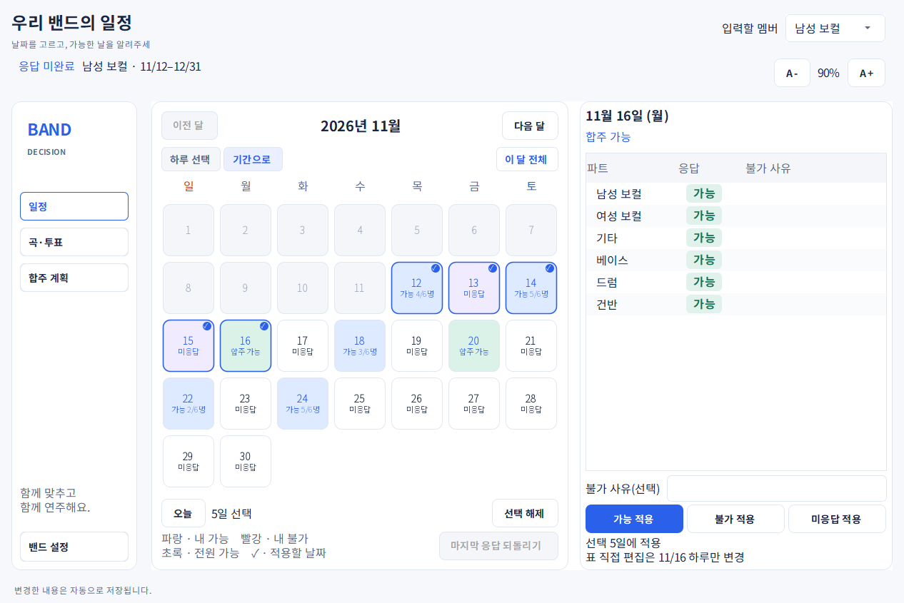

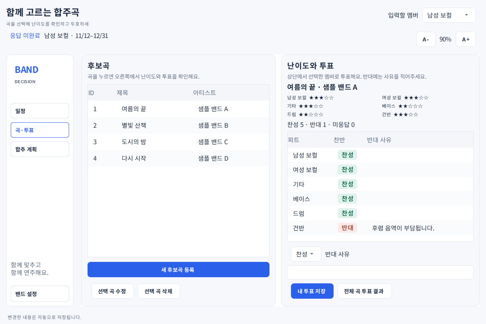

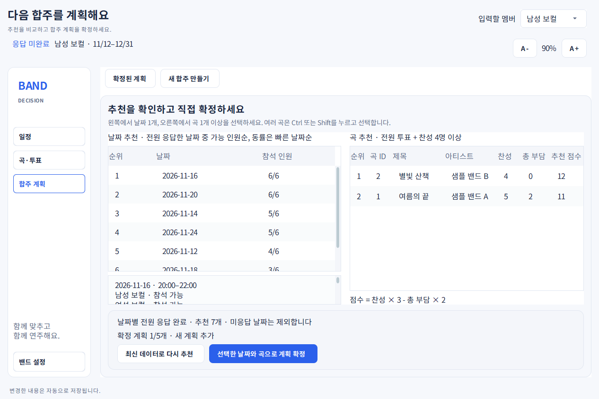

## V-20261112-02: 파란 캘린더 디자인 H30

- 2026-11-12, 개발 지원 도구가 Windows PowerShell/JDK 17.0.20.1에서 별도 임시 데이터로 실행. 사용자 저장 파일은 변경하지 않았다.
- `powershell -NoProfile -ExecutionPolicy Bypass -File .\build.ps1 -Test`: 종료 코드 0, 실제 출력 `PASS: 181 checks (candidate scheduling + songs + persistence + CLI)`와 `PASS: 151 Swing checks`. 총 332개, 실패·SKIP 없음.
- `java '-Dfile.encoding=UTF-8' -cp out GuiSmokeTest --render`: 종료 코드 0, 실제 출력 `PASS: 151 Swing checks`. 같은 검사의 반복이며 합산하지 않는다.
- 기존 날짜 선택·기간/월 전체·개인 색상·응답 편집·저장·되돌리기·월 경계·다중 계획과 90/100/140%·두 창 크기의 6개 탭 버튼 접근을 다시 확인했다. 디자인 구현을 그대로 따라 하는 별도 검사는 추가하지 않았다.
- 기본 달력/투표 화면과 1080×800·140%의 컴포넌트 렌더링을 직접 확인했다. 둥근 날짜, 응답/선택 분리, 파란 주 버튼, 연한 탭, 중복 사유 배지 제거와 스크롤 제공을 확인했다. 아래 확대 이미지는 하단 버튼 확인을 위해 스크롤한 상태다.
- 실제 마우스 전체 E2E, 사용자 미관 선호 확인, 다른 PC/DPI는 미검증이다. computer-use는 이번 작업에서 재시도하지 않았다. 기존 제한을 자동 검사로 대체해 완료 처리하지 않는다.
- 문서/이미지 정적 점검 Python 출력 `PASS: 9 documents, 72 local links, 2 H30 image hashes`, 종료 코드 0. 기능 검사 수에 합산하지 않는다.

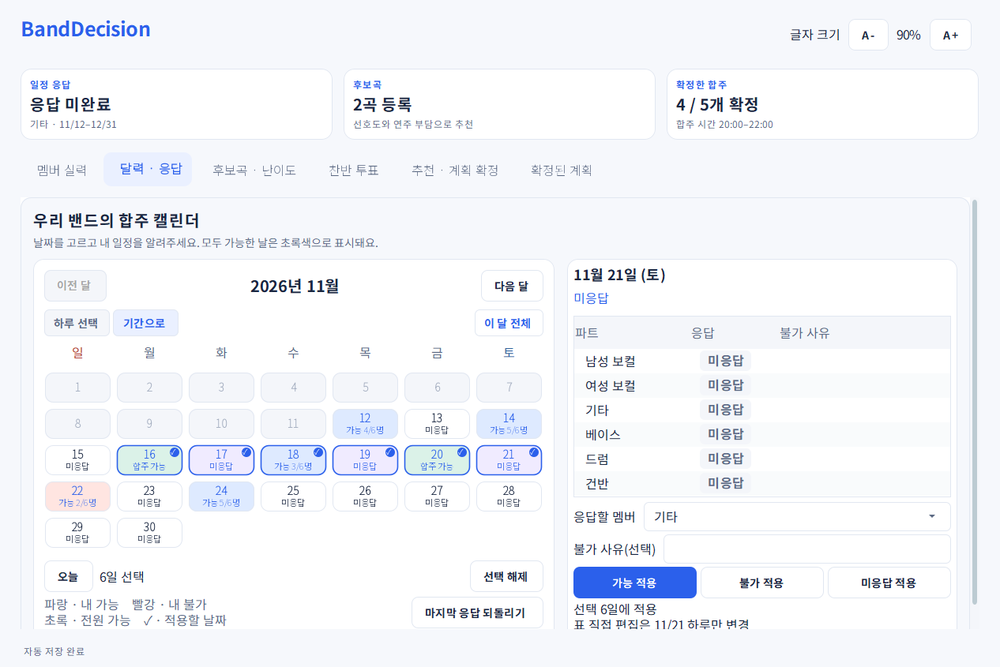

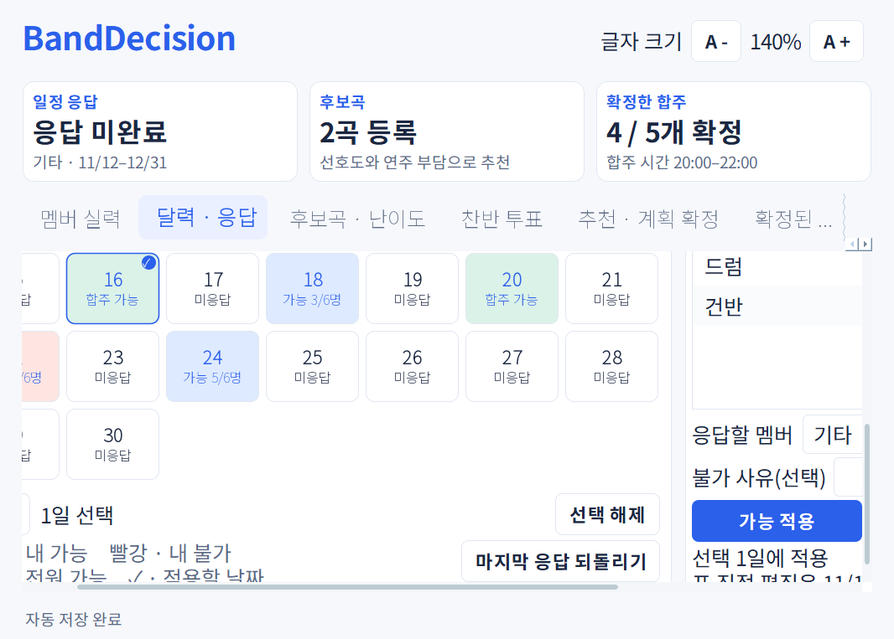

## V-20261112-01: 일정 기준·되돌리기·월 이동·화면 보완 H29

- 최종 실행일 2026-11-12. Windows PowerShell/JDK 17, 프로젝트 폴더에서 개발 지원 도구가 별도 임시 데이터로 실행. 사용자 저장 파일은 변경하지 않았다.
- 명령 `powershell -NoProfile -ExecutionPolicy Bypass -File .\build.ps1 -Test`: 종료 코드 0. 실제 출력:

```text
PASS: 181 checks (candidate scheduling + songs + persistence + CLI)
PASS: 151 Swing checks
```

- `java '-Dfile.encoding=UTF-8' -cp out GuiSmokeTest --render`: 종료 코드 0, `PASS: 151 Swing checks`. 반복 실행이므로 합계에 더하지 않는다.
- 기간/완료: 월초·월말·연말·윤년의 오늘/다음 달 말일 포함과 바깥 제외, 기간 전체 개인 응답 완료·마지막 날 미응답 시 미완료, 타인 응답의 개인 기준 불변, 말일 확정/그 다음 날 거절 통과. 기존 60일·기록일만 완료·기간 밖 편집 검사는 D23으로 대체했다.
- 되돌리기: 월 전체 응답과 사유 복원, 동일 값 재적용 후 이전 이력 유지, 다른 멤버 상태 보존, 표 직접 편집 복원, 선택 해제/멤버 전환 후 원래 대상 복원, 저장 재로드, 새 기록 제거, 실패 시 이력 없음·한 단계 제한 통과.
- 월 이동: 첫 달 이전 비활성·다음 활성, 다음 달 이동 후 이전 활성·다음 비활성. 비활성 버튼 재클릭은 월/선택 날짜 무변경. 현재 표시 월의 전체 선택·재클릭 해제와 기존 월 넘는 기간 선택 검사도 유지.
- 배치: 90/100/140% × 1080×800/1280×930 × 6개 탭에서 주요 버튼 전체가 페이지 스크롤로 접근 가능한지 검사. 각 조합에서 되돌리기 접근도 검사(총 42조건). 기본 90% 표 6행·표 너비·글자/행 높이 확대 검사를 유지했다. 실제 Windows DPI를 바꾼 검사는 아니다.
- 실패→수정: UI 재배치 후 응답표 viewport 높이 123px로 6행 검사 실패(종료 코드 1). 되돌리기 위치·페이지 높이·여백을 조정했다. 헤더를 줄여 공간을 회수하는 중 183px로 다시 실패해 상세 여백을 조정했고 최종 위 명령에서 통과했다. 기대 조건을 낮추지 않았다.
- 렌더링: 아래 기본 화면과 작은 창 140% 화면을 실제 컴포넌트 출력으로 확인했다. 기본 화면의 이전 달 비활성, 세 요약 카드, 응답표·적용 동작, 작은 창에서 가로/세로 스크롤 제공을 확인했다. 확대 화면은 하단 버튼 확인을 위해 스크롤한 상태다.
- 네이티브 검증 시도: computer-use 스킬의 node_repl 초기화가 `failed to write kernel assets: 지정된 경로를 찾을 수 없습니다. (os error 3)`로 실패. 커널 리셋 후 초기화 재시도도 동일. 실제 UI 입력은 하지 못했고 임시 검토용 Java 프로세스는 종료했다. GUI 모든 모달 승인/취소·전체 네이티브 E2E는 **미완료**. 사용자 창은 조작하지 않았다.
- 합계 332개는 H28 대비 80개 추가한 조건 검사 수다. 중간 181+150 및 181+151 반복 실행은 별도 합산하지 않는다. 동시 저장 충돌·권한/디스크 부족·다른 PC는 여전히 별도 미검증이다.
- [최종 명령과 출력](evidence/2026-11-12/test-results.txt)을 별도로 보관한다. 이 실행의 JDK는 `openjdk version "17.0.20.1"`, Temurin 17.0.20.1+1이다.
- 문서 정리 후 Python 정적 점검: `PASS: 9 documents, 70 local links, R01-R13/T01-T09, 2 image hashes`, 종료 코드 0. 링크 대상·요구사항/검사 ID·원본/증거 이미지 일치를 확인했으며 기능 검사 수에 합산하지 않는다.

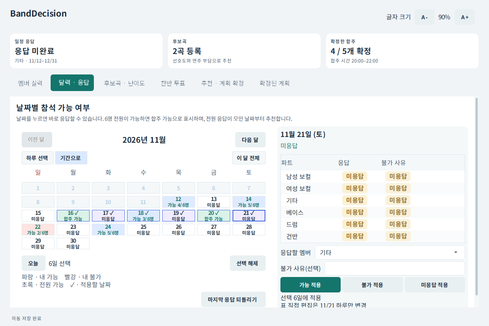

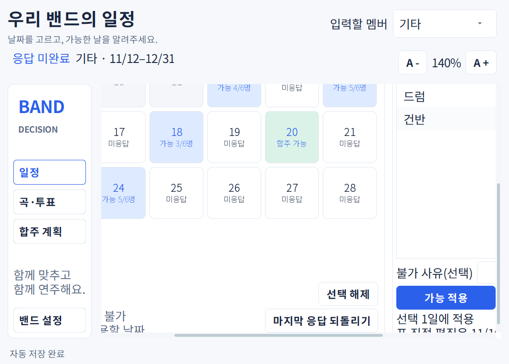

## V-20261111-13: 추가 오류 점검 H28

- 실행일 2026-11-11, 개발 지원 도구가 Windows PowerShell/JDK 17에서 프로젝트 폴더의 임시 데이터로 실행. 사용자 data 파일은 변경하지 않았다.
- 재현 1: 실제 JTable 셀 편집기를 열고 불가 사유 입력 후 멤버 콤보를 전환. 최초 `build.ps1 -Test`는 Acceptance 153개 통과 뒤 `멤버 전환 전에 편집 중 사유 반영·편집 종료` AssertionError로 종료 코드 1. 모델 행 재생성 전에 편집 중 값을 확정하지 않아 입력이 소실됐다.
- 수정 1: 달력 refresh 직전 finishEditing, 모델 변경 콜백 전에 removeEditor로 중첩 stopCellEditing 방지. 탭 변경과 windowClosing에도 편집 확정 후 저장. 실제 편집기 기반으로 멤버 전환·날짜 이동(원래 날짜만 변경)·탭 변경·종료 후 파일 복원을 검사했다. 창 종료는 WindowEvent 주입이며 실제 마우스 조작은 아니다.
- 재현 2: 임시 파일에 `invalid=` 뒤 잘못된 유니코드 이스케이프를 기록한 다음 save. `IllegalArgumentException: Malformed \\uxxxx encoding.`으로 Acceptance가 종료 코드 1. 기존 저장 실패 안내는 IOException만 처리해 이 예외를 안내하지 못했다. 시작점 Main은 이미 IllegalArgumentException을 처리하므로 시작 오류 안내가 없었다고 판단하지 않는다.
- 수정 2: Properties 읽기를 공통 readProperties로 모으고 문자 형식 예외를 IOException으로 변환. save 거절·원본 바이트 내용 유지, load와 isLegacy의 동일 예외 계약을 확인했다. 권한·디스크 부족 시험은 아니다.
- 최종 명령: `powershell -NoProfile -ExecutionPolicy Bypass -File .\build.ps1 -Test`, 종료 코드 0. 실제 출력:

```text
PASS: 156 checks (candidate scheduling + songs + persistence + CLI)
PASS: 96 Swing checks
```

- 총 252개 조건 검사, 실패·SKIP 없음. 이전 241개에 저장 검사 3개와 실제 편집기 검사 8개를 추가했다. 중간 실행 153+92, 156+94는 수정 도중 결과이며 최종 합계에 중복 합산하지 않는다.
- 이번 작업에서 화면 렌더링은 재실행하지 않았다. 모든 네이티브 확인창 수동 E2E·다른 DPI·동시 저장·권한/디스크 부족 검증은 여전히 남아 있다.
- 문서 반영 후 Python으로 Markdown 9개와 로컬 링크 68개 존재·최종 출력 문자열을 확인했다. 실제 출력 `PASS: 9 documentation files, 68 local links; H28 final outputs recorded`, 종료 코드 0. 기능 검사 252개에 합산하지 않는다.

## V-20261111-01: 문서화 시점 재검증

- 실행일: 2026-11-11. 분·초 단위의 실행 시각은 별도로 보존하지 않았다.
- 수행자: 개발 지원 도구의 명령 실행. 학생 본인의 수동 시연 결과가 아님.
- 작업 위치: `D:\UNIV\2-2\JAVA\Project\BandDecision`.
- 환경: Windows PowerShell, Eclipse Temurin OpenJDK 17.0.20.1, javac 17.0.20.1.
- 대상: 후보 날짜별 명시 응답 방식의 현재 소스. 이번 문서화 작업은 애플리케이션 코드를 변경하지 않았다.
- 실행: `powershell -NoProfile -ExecutionPolicy Bypass -File .\build.ps1 -Test`.
- 실제 종료 코드: 0.

```text
PASS: 96 checks (candidate scheduling + songs + persistence + CLI)
PASS: 26 Swing checks
```

출력 전사: [검사 실행 기록](evidence/2026-11-11/test-results.txt). 이 실행 당시 합계는 **122개 check 검사**이다. 독립적인 테스트 메소드 122개라는 뜻은 아니며, 건수만으로 전체 UI·모든 오류 상황을 검증했다는 결론을 내리지 않는다.

## 검사별 기대와 확인 결과 — H16 당시

| ID | 입력·행동/기대 결과 | 이번 실제 확인 | 근거 |
|---|---|---|---|
| V01 | 단일·쉼표·공백·혼합/범위·중복을 날짜 배열로 변환, 월·연도·윤년 경계, 잘못된 날짜 거부 | `dates()` 검사 통과. 고정 기준일 2026-10-28 및 윤년 별도 기준일 사용 | `AcceptanceTest.dates()` |
| V02 | 후보를 중복 없이 날짜순으로 추가. 범위 밖 날짜가 섞이면 부분 반영 금지 | 중복 제거와 전체 범위 검증 후 등록, 실패 시 후보 수 유지 검사 통과 | `attendance()` |
| V03 | 미응답을 가능으로 세지 않고 추천 차단. 새 후보에 대한 응답도 전부 필요 | 상태 0의 가능 인원 0, 전원 응답 전 예외, 새 후보 추가 후 차단 검사 통과 | `attendance()` |
| V04 | 등록 후보만 가능 인원 내림차순·날짜 오름차순 추천, 전원 불가 제외, 1명 가능은 허용, 과거 제외 | 위 조건 검사 통과 | `attendance()` |
| V05 | 멤버 초기 실력, 별점, 범위 검증, 곡 등록·난이도 수정·투표 유지·사유 필수/삭제 | 관련 상태 검사 통과 | `songs()` |
| V06 | 곡 추천 자격과 `3×찬성 - 2×부담`, 최신 실력·난이도 반영, 동점과 음수 점수 | 관련 수치/정렬 검사 통과. 미응답 곡 추천 보류와 찬성 부족 미추천 검사 포함 | `songs()` |
| V07 | 부분 참석 별도 승인, 후보 아닌 날짜/빈 곡/중복/미추천 곡 거부, 마지막 응답 변경 재검증 | 예외·성공·기존 확정 객체 유지 검사 통과. 후보 삭제 후 스냅샷 유지 검사 포함 | `plans()` |
| V08 | 잘못된 콘솔 메뉴 복구, 후보 등록, 가능 응답, 실력 수정, 추천 후보로 확정/조회 | 입력 스트림을 주입한 콘솔 검사 통과 | `console()` |
| V09 | 저장/불러오기 시 후보·미응답·한글/줄바꿈 사유·실력·곡 투표·확정 기록 유지 | 별도 임시 폴더에서 복원 검사 통과. 사용자 data 파일은 사용하지 않음 | `persistence()` |
| V10 | v1 로드 시 곡·실력·투표·확정 보존, 새 가능 여부 추측 금지, 백업 원본 동일, 손상 파일 보존 | 합성 v1 파일로 검사 통과. 실제 사용자 파일 전체를 대상으로 한 변환 시험은 아님 | `persistence()` |
| V11 | GUI 6탭, 후보 7개/9열, 응답 칸만 편집 가능, 미응답 선택 시 추천 차단 및 복원 | Swing 컴포넌트를 EDT에서 생성·선택·편집한 검사 통과. 실제 마우스 입력은 아님 | `GuiSmokeTest` |
| V12 | 후보곡 표 가로 빈 공간 제거, 투표 6명 행 표시, 사유 열 확대, 확대와 행 높이 연동 | 지정 창 크기에서 실제 계산된 컴포넌트 크기/값을 검사하여 통과 | `GuiSmokeTest` |

## UI 검사 방법과 한계

`GuiSmokeTest`는 EDT에서 실제 Swing 컴포넌트를 만들고 `doClick()` 또는 모델 입력으로 서비스/저장 연결을 확인한다. 기본 배율 90%, 후보곡 표는 1500×980, 투표 표는 1280×930 창 크기 조건에서 검사한다. 다른 해상도와 운영체제 배율에서도 같은 결과라는 의미는 아니다.

초기 GUI 작업에서는 네이티브 창이 실행됐으나 화면 자동 캡처 도구의 승인 대기가 만료됐다. 이후 `printAll()`로 Swing 화면을 이미지로 렌더링하고 여백·글자·표 배치를 확인했다. **렌더링 확인을 실제 사용자가 모든 모달 창을 마우스로 통과한 것처럼 기록하지 않는다.**

## H16 당시 화면 증거 — 과거 화면

아래 이미지는 후보 방식 변경 작업에서 2026-11-11에 생성한 `out/gui-preview` 렌더링 결과를 문서 폴더로 복사한 것이다. 이번 문서화 요청에서 `--render`를 다시 실행한 것으로 표기하지 않는다. 일상 테스트가 임시 데이터를 수정한 화면이므로 사용자의 실제 밴드 데이터가 아니다.

### 후보 날짜별 가능 여부

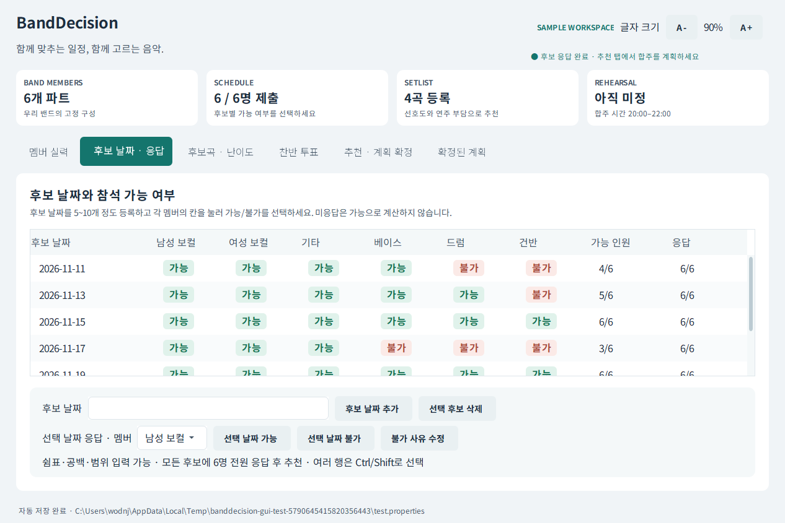

### 멤버별 찬반 투표

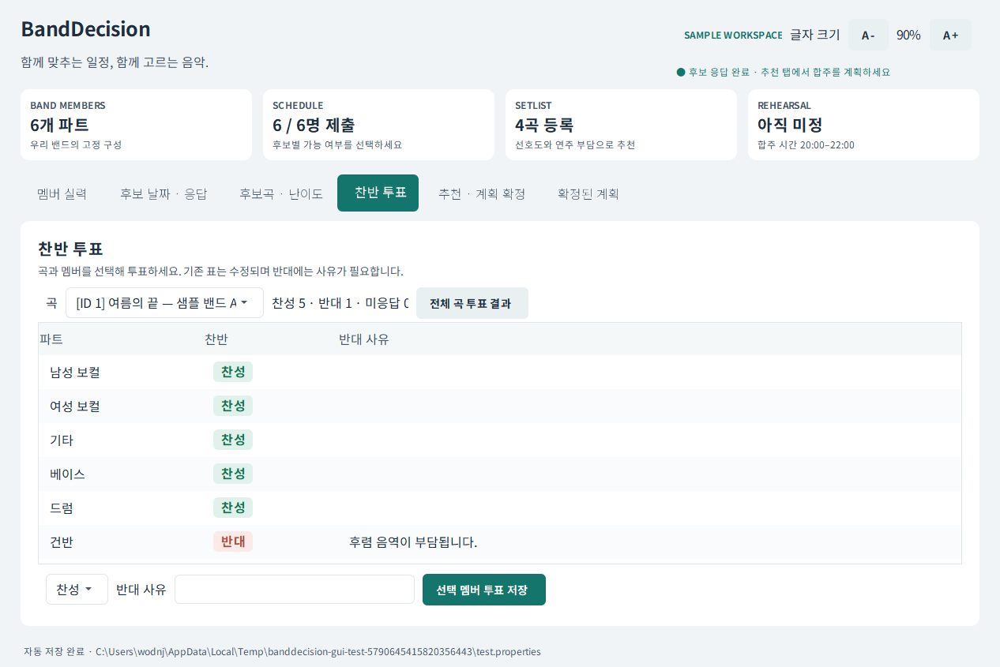

### 후보 날짜·합주곡 추천

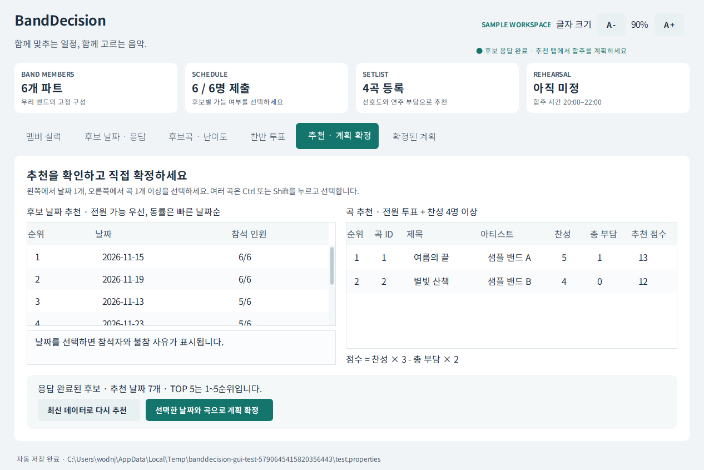

## 과거 확인 결과와 현재 결과 구분

| 과거 작업 | 그때 확인한 내용 | 현재 적용 범위 |
|---|---|---|
| 초기 콘솔 | 메뉴 입력, 예외 복구, 원래의 불가능 일정과 60일 전수 추천 | 메뉴·곡·확정 구조의 이력. 예전 일정 정책의 통과를 현재 정책의 증거로 합산하지 않음 |
| 한글 인코딩 수정 | PowerShell 런처로 ‘일정’ 입력→저장→조회 | 당시 실제 왕복 시험. 이번에는 런처별 콘솔 인코딩을 다시 전부 시험하지 않음 |
| 파일 저장 추가 | 두 번의 Java 실행에서 변경된 실력과 확정 계획 복원 | 당시 프로세스 간 복원 확인. 현재는 후보 데이터의 임시 파일 복원 검사 수행 |
| 긴 날짜 확인창 | 365개 날짜를 스크롤 표로 표시, 같은 창 크기 | 구방식 화면은 현재 제거됨. 후보 추가의 스크롤 확인 UI와 혼동 금지 |
| 글자·표 레이아웃 | 배율 변경·표 크기·투표 6행 검사, 이미지 렌더링 | 현재 GUI 검사에서도 배율·표 크기 조건을 재확인 |

## 이번에 수행하지 않은 검사

- 실제 마우스로 후보 추가 확인, 후보 삭제 취소, 사유 입력, 곡 등록, 부분 참석 경고, 최종 확정, 저장 실패 대화상자를 전부 이어서 조작하는 수동 E2E.
- 여러 프로그램에서 동일 파일을 동시에 저장하는 충돌·잠금 시험.
- 디스크 용량 부족, 쓰기 권한 거부, 강제 종료 중 저장, 원자적 이동 미지원 환경의 대체 경로.
- 다른 PC, 모든 Windows DPI, 140% 글자, 키보드 전용 조작·접근성 도구의 전체 화면 시험.
- 제출할 ZIP을 새 폴더/다른 PC에 풀고 타인이 실행하는 시험.

이 항목은 ‘실패했다’가 아니라 ‘미검증/미구현’이다. 다음 실행 때 결과와 날짜를 추가하고 이전 기록은 유지한다.

## 문서화 산출물 확인

2026-11-11 Python 검사로 관련 Markdown 9개에서 로컬 파일 링크 32개를 확인했으며 깨진 링크는 없었다. 문서 폴더에 복사한 화면 이미지 3개는 원본과 SHA-256이 일치했다. 이 검사는 애플리케이션 기능 검사 122개에 더하지 않는다.

## 재현 명령

### V-20261111-12: 평가 문서 구조와 근거 연결 점검

- H26의 문서 보완과 H27 결과 반영 후 개발 지원 도구가 Python으로 관련 Markdown 10개를 점검했다. 기능 검사를 추가 실행한 것으로 합산하지 않는다.
- 평가 6개 항목의 배점이 15/20/20/15/20/10이며 합계 100%임을 확인했다. 요구사항 R01~R12, 시나리오 S1~S4, 조건별 검사 T01~T08의 순서·중복 여부를 확인했다.
- 로컬 링크 68개의 대상 파일 존재, 설계에 기재한 주요 Java 소스 12개 존재, SCHEDULE 증거 이미지의 원본/보관본 SHA-256 일치를 확인했다.
- 첫 점검 스크립트는 정규식 오류로 중단됐다. 검사 정규식을 수정해 재실행한 결과 아래 출력과 종료 코드 0을 확인했다. 이 오류는 애플리케이션 테스트 실패가 아니다.

```text
PASS: 10 documents, 68 local links
PASS: 6 rubric weights total 100%; R01-R12, S1-S4, T01-T08; design source files
PASS: schedule image SHA-256 matches
```

- 요구사항/코드 관계와 현재/과거 정책은 소스·이력과 대조해 설명을 보완했다. 링크 존재·ID 검사만으로 문서의 모든 의미가 자동 검증됐다고 주장하지 않는다. 동료 검토·학생 직접 시연·다른 PC 실행·실제 제출은 미완료다.

### V-20261111-11: SCHEDULE 선택 멤버 완료 표시

- Windows PowerShell, Eclipse Temurin JDK 17.0.20.1, UTF-8. 개발 지원 도구가 임시 파일로 실제 실행했다.
- 원인 확인: 실제 저장 파일을 읽기만 하여 개인 완료와 다른 멤버 미완료가 함께 있는 상태를 확인했다. 코드는 밴드 전체 완료를 SCHEDULE에 표시하고 있었다. 사용자 응답을 변경하거나 초기화하지 않았다.
- `powershell -NoProfile -ExecutionPolicy Bypass -File .\build.ps1 -Test`: 종료 코드 0. 실제 출력 `PASS: 153 checks (candidate scheduling + songs + persistence + CLI)` 및 `PASS: 88 Swing checks`, 총 241개, 실패·SKIP 없음.
- 재현 조건을 임시 데이터로 구성해 선택 멤버만 완료한 경우 응답 완료 표시, 다른 멤버로 전환 시 미완료/대상 이름 갱신, 돌아올 때 완료 복원, 전환 전후 파일 바이트 동일을 검사했다. 기존 날짜 추천·계획·호환 검사도 통과했다.
- `java "-Dfile.encoding=UTF-8" -cp out GuiSmokeTest --render`: 종료 코드 0, `PASS: 88 Swing checks`. 같은 검사의 반복이므로 합계에 더하지 않는다. SCHEDULE의 선택 멤버 이름과 완료 상태를 이미지로 확인했다.
- 네이티브 전체 수동 조작·다른 DPI/140% 검증은 미완료다. [실제 출력](evidence/2026-11-11/schedule-status-test-results.txt).


### V-20261111-10: 불필요한 코드·중복 화면 정리

- Windows PowerShell, Eclipse Temurin JDK 17.0.20.1, UTF-8에서 개발 지원 도구가 별도 임시 데이터로 실행했다.
- `powershell -NoProfile -ExecutionPolicy Bypass -File .\build.ps1 -Test`: 종료 코드 0. 출력 `PASS: 153 checks (candidate scheduling + songs + persistence + CLI)` 및 `PASS: 84 Swing checks`. 총 237개, 실패·SKIP 없음. 폐기한 후보 사전 등록 API 전용 검사 2개를 제거해 이전 239개와 구분한다.
- `java "-Dfile.encoding=UTF-8" -cp out GuiSmokeTest --render`: 종료 코드 0, `PASS: 84 Swing checks`. 같은 Swing 검사 반복이므로 합계에 더하지 않는다. 후보곡 화면에서 중복 난이도 저장 줄 제거와 등록/수정/삭제 버튼·전체 폭 표를 확인했다.
- 마지막 미사용 import 2개 제거 후 `powershell -NoProfile -ExecutionPolicy Bypass -File .\build.ps1`를 실행해 종료 코드 0으로 컴파일했다. 이후 전체 검사를 다시 실행했다고 표기하지 않는다.
- 기존 날짜 응답·일반/기간/월 전체 선택·지난 날짜 비활성·개인 응답 색상·곡/투표·계획 최대 5개·수정/삭제·v1/v2/v3 복원·백업 검사가 통과했다. 계획 검사는 단일 조회 편의 API 대신 실제 목록 ID로 접근한다.
- 호출 검색으로 제거 대상이 실제 미사용/폐기된 정책인지 확인했다. 원본 소스가 없는 class 3개도 생성물 폴더에서 제거했다. Swing 프레임워크가 호출하는 override 메소드는 단순 참조 횟수만으로 삭제하지 않았다.
- 전체 투표 결과 모달은 조회 시 생성하도록 변경했으며 실제 마우스로 모달을 열고 닫는 전체 E2E는 이번에 수행하지 않았다. 다른 DPI·140% 및 기존 저장 오류 주입도 미완료다. 사용자 저장 파일·과거 기록은 변경하지 않았다. [실제 출력](evidence/2026-11-11/cleanup-test-results.txt).

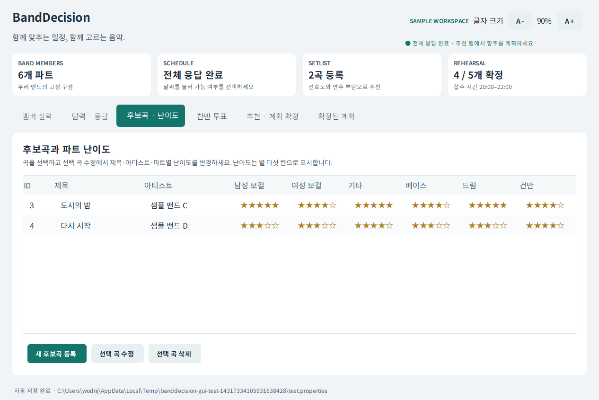

### V-20261111-09: 일반 클릭 단일 날짜 선택

- Windows PowerShell, Eclipse Temurin JDK 17.0.20.1, UTF-8. 개발 지원 도구가 별도 임시 데이터로 실제 실행했다.
- `powershell -NoProfile -ExecutionPolicy Bypass -File .\build.ps1 -Test`: 종료 코드 0. 출력 `PASS: 155 checks (candidate scheduling + songs + persistence + CLI)` 및 `PASS: 84 Swing checks`, 총 239개, 실패·SKIP 없음.
- 일반 클릭을 연속 수행해도 마지막 날짜 한 개만 남고, 동일 날짜 재클릭도 유지되는 것을 확인했다. 기존 누적 선택/해제 검사를 대체했으므로 검사 수는 같다. 기간·월 전체·재클릭 전체 해제·응답 저장·계획 관리의 기존 검사도 통과했다.
- 렌더링과 네이티브 전체 수동 조작은 이번에 실행하지 않았다. 사용자 저장 파일도 변경하지 않았다. 과거 이미지·출력 증거는 당시 기록으로 유지한다.

### V-20261111-08: 지난 날짜 잠금·전체 선택 전환·계획 최대 5개

- 환경: Windows PowerShell, Eclipse Temurin JDK 17.0.20.1, UTF-8. 개발 지원 도구가 별도 임시 데이터로 실제 실행했다.
- `powershell -NoProfile -ExecutionPolicy Bypass -File .\build.ps1 -Test`: 종료 코드 0, `PASS: 155 checks (candidate scheduling + songs + persistence + CLI)` 및 `PASS: 84 Swing checks`. 총 239개, 실패·SKIP 없음. 이전 숫자는 합산하지 않는다.
- `java "-Dfile.encoding=UTF-8" -cp out GuiSmokeTest --render`: 종료 코드 0, `PASS: 84 Swing checks`. 같은 검사의 반복이므로 합계에 추가하지 않는다.
- 달력 기대/실제: 지난 날짜 칸 비활성·클릭 무효·기존 응답 읽기 전용·모델 편집 무시를 확인했다. 월 전체는 현재 달의 오늘~월말, 다음 달은 전체 날짜를 선택했고 동일 버튼 재클릭 시 해제했다.
- 계획 도메인/파일: 5개 추가·6번째 거절 및 원본 보존, 5개 상태의 수정·부분 참석 동의·최신 응답 재검증, 선택 ID만 변경·다른 계획 보존, 중간 삭제 후 ID 유지/새 ID 추가, 전체 삭제 후 다음 ID 복원, 스냅샷의 곡 삭제 영향 없음, v1/v2 단일 계획 복원과 v2 원본 백업 일치를 확인했다. 5개 초과/잘못된 다음 ID 파일은 읽기를 거부했다.
- 콘솔: 계획 수정, 삭제 취소, 삭제 후 응답 보존을 입력 주입으로 확인했다.
- Swing: 5개 목록·신규 확정 제한, 5개에서도 수정 진입·기존 날짜 선택 복원, 수정 취소 보존, 서비스 수정/삭제 후 목록·선택 ID 유지, 삭제 후 신규 확정 허용, 여러 계획과 수정 내용 저장 복원을 확인했다. 실제 GUI 최종 승인·삭제 확인창을 마우스로 조작한 검사와 구분한다.
- 이미지: 달력의 지난 날짜 회색 상태와 계획 목록·조회·관리 버튼, 추천 화면 배치를 컴포넌트 렌더링으로 확인했다. 네이티브 전체 수동 시연·다른 DPI/140% 검증은 미완료다. 사용자 저장 파일은 수정하거나 직접 전환하지 않았다. [실제 출력](evidence/2026-11-11/five-plans-test-results.txt).

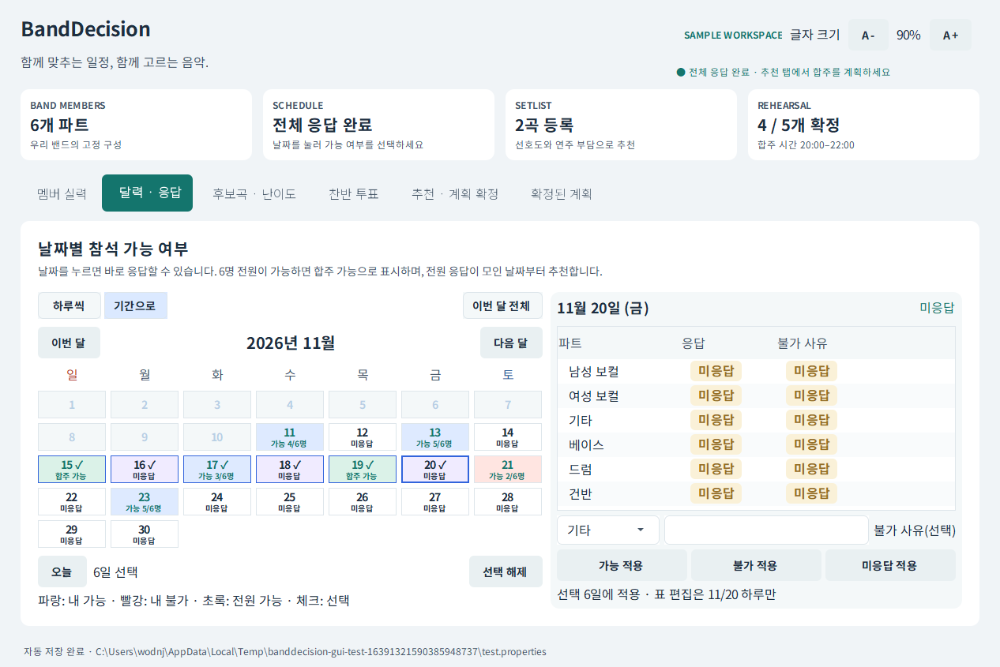

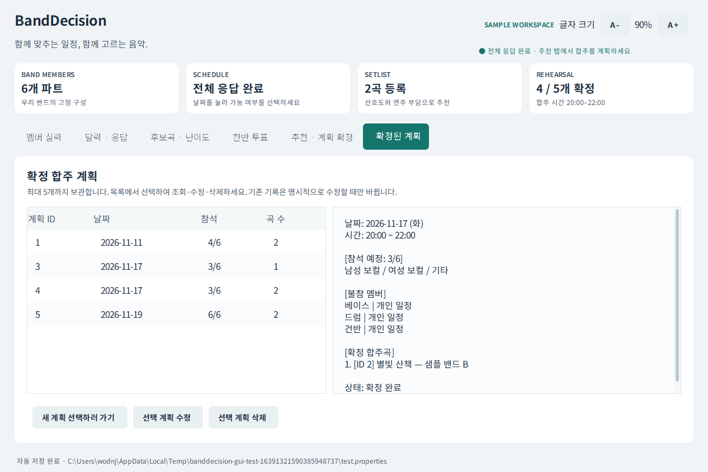

### V-20261111-07: 개인 응답 색상과 완료 여부 요약

- 환경: Windows PowerShell, Eclipse Temurin JDK 17.0.20.1, UTF-8. 개발 지원 도구가 임시 데이터로 실행했다.
- `powershell -NoProfile -ExecutionPolicy Bypass -File .\build.ps1 -Test`: 최종 종료 코드 0, 출력 `PASS: 131 checks (candidate scheduling + songs + persistence + CLI)`와 `PASS: 72 Swing checks`. 총 203개, 실패·SKIP 없음.
- 기대/실제: 멤버 표의 응답 완료/미응답과 상단 전체 완료/미완료 전환을 확인했다. 전체 미완료여도 응답 완료된 다른 날짜의 추천이 유지된다. 응답 일수는 표시하지 않는다.
- 색상 검사: 선택 해제·월 이동 후 불가 배경 유지, 멤버 전환 시 해당 멤버의 가능 배경, 저장 파일로 다시 만든 달력에서 불가 색상 복원, 미응답으로 되돌릴 때 저장 응답 배경 제거와 현재 선택의 연보라 표시를 확인했다. 전원 가능 초록과 체크 선택은 구분한다.
- 선택 멤버 설정 자체의 재실행 복원은 구현하지 않았다. 재실행 후 같은 멤버를 선택하면 응답 데이터로 색상이 복원된다. 실제 네이티브 전체 수동 조작·다른 DPI/140% 검증은 미완료다. 사용자 저장 파일은 변경하지 않았다.
- `java "-Dfile.encoding=UTF-8" -cp out GuiSmokeTest --render`: 종료 코드 0, `PASS: 72 Swing checks`. 같은 검사의 반복 실행으로 합계에 추가하지 않는다. 이미지에서 응답 완료 요약·개인 응답 배경·선택 체크와 연보라 배경·6행 배치를 확인했다. [실제 출력](evidence/2026-11-11/personal-response-test-results.txt).

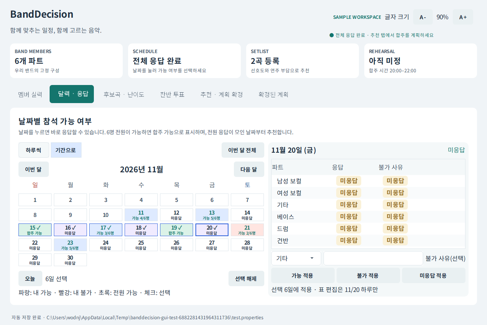

### V-20261111-06: 클릭 다중 선택·응답 적용

- 환경: Windows PowerShell, Eclipse Temurin JDK 17.0.20.1, UTF-8. 개발 지원 도구가 별도 임시 데이터로 실행했다.
- `powershell -NoProfile -ExecutionPolicy Bypass -File .\build.ps1 -Test`: 최종 종료 코드 0. 출력 `PASS: 131 checks (candidate scheduling + songs + persistence + CLI)`와 `PASS: 65 Swing checks`. 총 196개이며 과거 수를 합산하지 않는다.
- `java "-Dfile.encoding=UTF-8" -cp out GuiSmokeTest --render`: 종료 코드 0, `PASS: 65 Swing checks`. 반복 실행한 같은 검사이므로 합계에 추가하지 않는다.
- 기대/실제: 하루씩 복수 선택과 재클릭 해제, 빈 선택 시 적용 불가, 시작일만 선택했을 때 적용 차단, 역순 기간의 양끝 포함, 월을 넘는 기간, 표시 월 전체 날짜 선택, 모드 변경 시 초기화를 검사해 통과했다. 선택은 저장 데이터를 바꾸지 않으며 적용 후에는 선택을 유지한다.
- 다중 응답: 지정 멤버만 불가/가능/미응답 적용, 사유 공란 시 기존 사유 유지, 가능으로 변경 시 사유 제거, 파일 저장 복원을 확인했다. 잘못된 날짜가 섞인 요청은 전체 검증 후 거부되어 앞 날짜도 변경하지 않았다. 빈 선택·잘못된 멤버도 거부했다.
- 최초 실행의 기본 90% 레이아웃 검사는 응답표 viewport 높이 183px로 실패했다. 상세 영역 여백을 조정한 후 동일 조건에서 6행 동시 표시 검사를 통과했다. 최종 검사에는 실패·SKIP이 없었다.
- 아래는 Swing 컴포넌트 렌더링이다. 선택 체크·선택 수·모드·전체 선택·멤버/사유 입력·적용 버튼 및 오른쪽 6행 배치를 확인했다. 실제 네이티브 마우스 전체 E2E, 다른 DPI/140% 전체 화면 검증은 미완료다. 사용자 저장 파일은 변경하지 않았다. [실제 출력](evidence/2026-11-11/multi-date-test-results.txt).

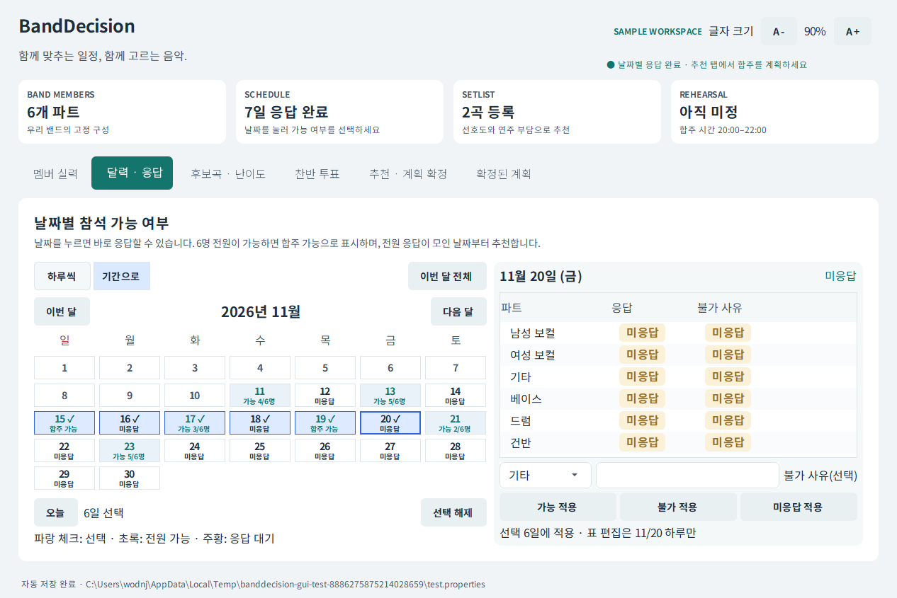

### V-20261111-05: 사전 후보 등록 없는 날짜 응답

- 환경: Windows PowerShell, Eclipse Temurin JDK 17.0.20.1, UTF-8. 개발 지원 도구가 별도 임시 데이터로 실행했다.
- `powershell -NoProfile -ExecutionPolicy Bypass -File .\build.ps1 -Test`: 종료 코드 0, 실제 출력 `PASS: 123 checks (candidate scheduling + songs + persistence + CLI)`와 `PASS: 53 Swing checks`. 총 176개, 실패·SKIP 없음.
- `java "-Dfile.encoding=UTF-8" -cp out GuiSmokeTest --render`: 종료 코드 0, `PASS: 53 Swing checks`. 같은 검사의 렌더링 실행이므로 합계에 추가하지 않는다.
- 기대/실제: 미기록 날짜 조회는 저장 행을 만들지 않고 6명 미응답을 반환했다. 첫 응답은 사전 등록 없이 저장·복원됐다. 잘못된 최초 응답은 저장 행을 만들지 않았다. 날짜별 전원 응답 완료 시 추천에 추가됐고 다른 미응답 날짜는 완료 날짜를 차단하지 않았다. 선택 날짜 미응답은 확정 거절, 다른 날짜 미응답은 확정 허용으로 확인했다.
- 경계: 과거·오늘+60일부터는 전원 가능이어도 추천 제외, 오늘+59일은 추천 포함. 미등록 날짜도 6행 편집 가능하고 후보 추가/삭제 버튼은 없음을 검사했다. 콘솔 날짜 직접 입력·조회 수정, 기존 곡·투표·확정 스냅샷·파일 복원도 검사했다.
- 렌더링: 아래 이미지에서 달력의 미응답 표시, 바로 편집하는 오른쪽 6행, 후보 관리 영역 제거를 확인했다. 실제 네이티브 전체 수동 조작·다른 DPI/140% 검증은 미완료다. 사용자 저장 파일은 변경하지 않았다.
- 기존 전체 후보 응답 완료 조건의 검사는 D14의 날짜별 정책으로 대체했으며 이전 결과를 현재 수에 더하지 않는다. [실제 검사 출력](evidence/2026-11-11/direct-date-response-test-results.txt).

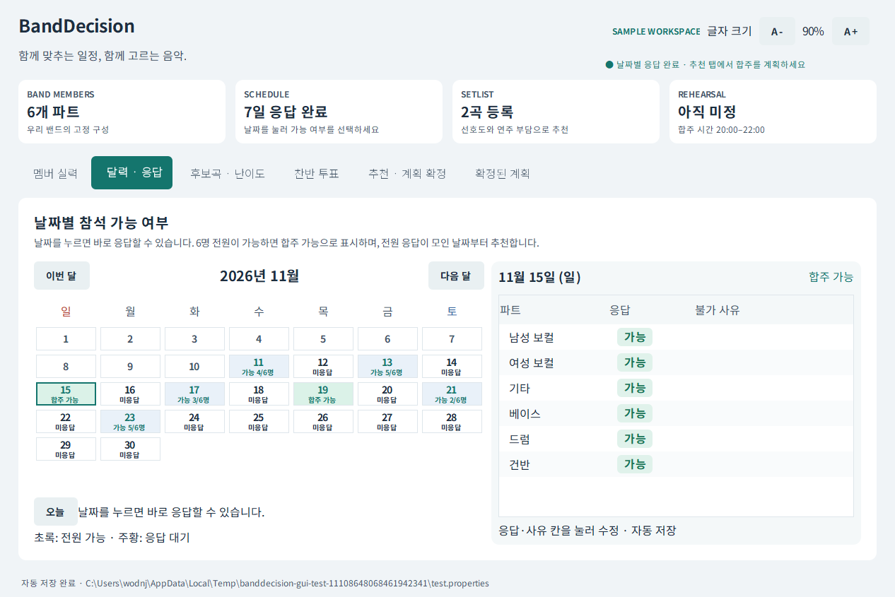

### V-20261111-04: 이번 달·다음 달 표시 제한

- Windows PowerShell, Eclipse Temurin JDK 17.0.20.1, UTF-8에서 개발 지원 도구가 임시 데이터로 실행했다.
- `powershell -NoProfile -ExecutionPolicy Bypass -File .\build.ps1 -Test`: 종료 코드 0. 실제 출력 `PASS: 117 checks (candidate scheduling + songs + persistence + CLI)` 및 `PASS: 50 Swing checks`. 합계 167개이며 이전 수치를 합산하지 않는다.
- 이전 달 버튼 없음, 이번 달 복귀, 다음 달 반복 클릭해도 두 달 뒤 진입 금지, 범위 밖 날짜 선택 시 표시 범위 유지, 기존 후보의 목록 선택과 응답 편집을 검사해 통과했다. 임의 연도 이동 검사는 새 정책에 따라 대체했다. 기본 90%에서 6명 동시 표시와 기존 저장 복원 검사도 통과했다.
- 자동 검사와 실제 마우스의 전체 네이티브 E2E는 구분한다. 다른 DPI/140% 및 확인창 전체 수동 조작은 미검증이다. 사용자 저장 파일은 변경하지 않았다.
- `java "-Dfile.encoding=UTF-8" -cp out GuiSmokeTest --render`: 종료 코드 0, `PASS: 50 Swing checks`. 같은 검사를 반복한 것이므로 합계에 더하지 않는다. 렌더링 이미지에서 이번 달/다음 달 버튼과 오른쪽 6명 표시를 확인했다.


### V-20261111-03: 달력과 멤버 상세 응답

- 환경: Windows PowerShell, Eclipse Temurin JDK 17.0.20.1, UTF-8. 개발 지원 도구가 프로젝트 폴더에서 실제 실행했으며 임시 데이터만 사용했다.
- `powershell -NoProfile -ExecutionPolicy Bypass -File .\build.ps1 -Test`: 최종 종료 코드 0, `PASS: 117 checks (candidate scheduling + songs + persistence + CLI)`와 `PASS: 48 Swing checks`. 합계 165개이며 과거 검사 수를 합산하지 않는다.
- `java "-Dfile.encoding=UTF-8" -cp out GuiSmokeTest --render`: 종료 코드 0, `PASS: 48 Swing checks`. 동일 검사의 렌더링 실행이므로 48개를 추가 합산하지 않는다.
- 기대/실제: 날짜 버튼 클릭 시 해당 날짜 6명 응답 표시, 전원 가능/일부 가능/미응답 상태 변경, 불가 사유 편집 및 공란 기본값, 새 후보 전원 미응답과 추천 차단, 잘못된 날짜에 응답하지 않도록 선택 유지, 수정과 저장 복원이 모두 기대대로 동작했다.
- 경계/배치: 이전/다음 달, 연말 연도 이동, 윤년 2월 29일, 과거/60일 범위 밖 등록 차단, 미등록 날짜를 합주 가능으로 표시하지 않음, 기본 90%에서 오른쪽 멤버 6행 동시 표시 검사 통과.
- 실패 후 수정: 최초에는 전원 가능이 아닌 샘플을 선택한 검사 기대값이 실패하여 전원 가능 샘플로 수정했다. 이후 기본 창의 응답표 높이 검사가 실패하여 후보 입력을 달력 아래로 옮기고 상세 영역을 조정했다. 최종 재실행에서는 실패·SKIP이 없었다.
- 화면 확인: 아래 이미지는 실제 네이티브 캡처가 아닌 Swing 컴포넌트 렌더링이다. 날짜/상태 표시와 오른쪽 6명 응답, 후보 입력·삭제 버튼의 배치를 확인했다. 실제 마우스로 후보 삭제 승인/취소·모든 대화상자를 연결한 E2E 및 다른 DPI/140% 글자 검증은 미완료다.
- 증거: [달력 검사 출력](evidence/2026-11-11/calendar-test-results.txt). 기존 증거 파일은 유지한다.

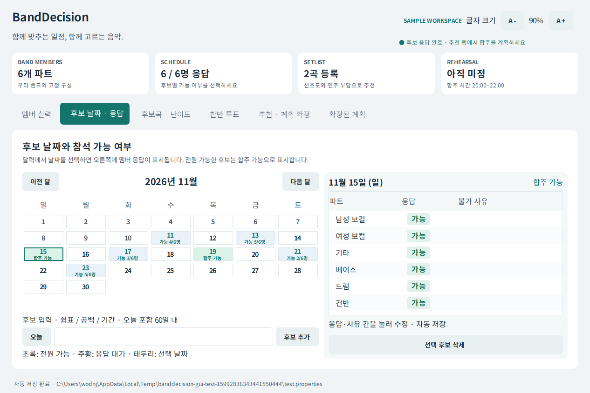

### V-20261111-02: 후보곡 수정·삭제 추가 후

- 환경: Windows PowerShell, Eclipse Temurin JDK 17.0.20.1, UTF-8. 프로젝트 폴더에서 개발 지원 도구가 실제 실행했다.
- `powershell -NoProfile -ExecutionPolicy Bypass -File .\build.ps1 -Test`: 종료 코드 0. 출력은 `PASS: 117 checks (candidate scheduling + songs + persistence + CLI)` 및 `PASS: 30 Swing checks`였다. 합계 147개 검사이며 이전 122개를 합산하지 않는다.
- `java "-Dfile.encoding=UTF-8" -cp out GuiSmokeTest --render`: 종료 코드 0, `PASS: 30 Swing checks`. 동일 Swing 검사의 렌더링 실행이므로 별도 30개로 합산하지 않는다.
- 기대/실제: 수정 후 ID·투표·반대 사유 유지, 난이도 반영과 잘못된 입력의 전체 변경 거부를 확인했다. 중간/마지막/전체 삭제 뒤 ID 재사용 방지, 저장 복원, 추천 제외, 확정 스냅샷 보존이 기대대로 동작했다. 콘솔 수정·삭제 및 삭제 취소도 입력 주입으로 확인했다.
- Swing 검사: 수정·삭제 버튼 존재, 서비스 수정 후 표/곡 선택 표시 갱신, 앞 곡 삭제 시 선택한 투표 대상 ID 유지, 선택 곡 삭제 시 선택 해제와 투표 표 비우기를 확인했다. 실제 수정 대화상자 OK/취소나 삭제 확인창을 마우스로 조작한 검사는 아니다.
- 화면: 아래 컴포넌트 렌더링에서 수정·삭제 버튼과 난이도 조작 영역이 잘리지 않는 것을 확인했다. 네이티브 수동 E2E, 저장 권한 오류·다른 DPI 검증은 여전히 미완료다. 테스트는 임시 데이터로 수행하여 사용자 저장 파일을 변경하지 않았다.
- 출력 증거: [후보곡 관리 검사 출력](evidence/2026-11-11/song-management-test-results.txt).

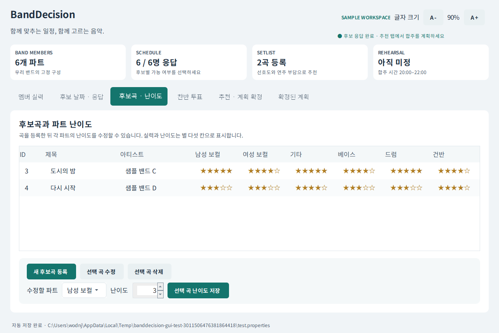

```powershell
.\build.ps1 -Test
java "-Dfile.encoding=UTF-8" -cp out GuiSmokeTest --render
.\run-gui.ps1 -Demo
```

두 번째 명령은 선택적인 화면 렌더링이다. 실행하지 않았으면 출력·이미지 시각을 갱신한 것으로 적지 않는다. 테스트가 `SKIP`을 출력하면 통과 건수에 포함하지 않는다.
